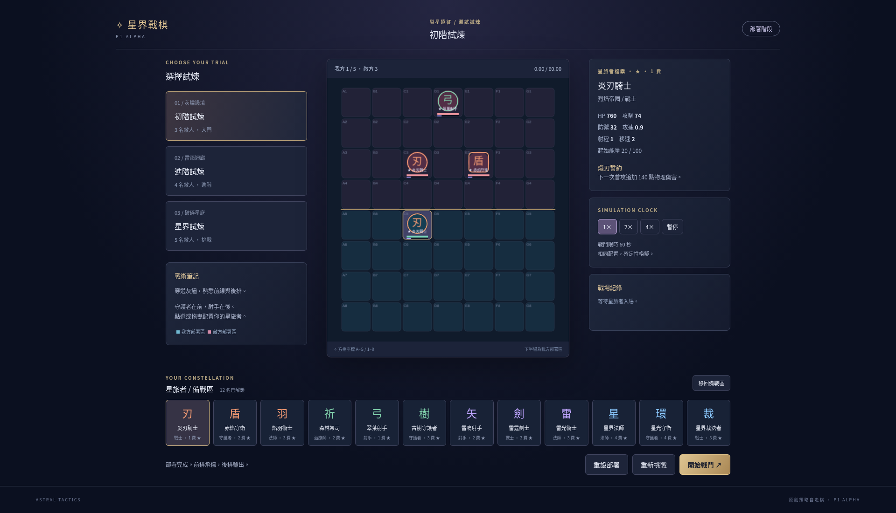

# 星界戰棋 · Astral Tactics

原創 2D 奇幻策略自走棋，**P1 Alpha**。星環崩裂後，四個陣營的星旅者在破碎星庭中接受試煉。單人 PvE，以自由部署、站位與真正的自動戰鬥為核心；不需帳號、後端、資料庫或金鑰。



## 已完成功能

- 繁體中文主選單、12 名一星角色圖鑑、操作指南與 LocalStorage 設定。
- Phaser 3 方格棋盤（7×8），上下各四排，座標、資料與畫面分離。
- 自由選擇 12 名角色，最多部署五名，可重複選用；點選移動、拖曳、交換、移除及右鍵資訊。
- 三關固定敵陣：初階 3 名、進階 4 名、星界 5 名。
- 固定步進戰鬥：尋敵、BFS 尋路、普攻、能量、十二種獨立資料驅動技能、治療、護盾、限時增益與死亡。
- 1× / 2× / 4×、暫停、戰鬥特效、血量與能量條、傷害文字、結算與每名角色傷害統計。
- 重試保留原部署但清除戰鬥狀態；重設清空部署。戰鬥中禁止調整站位。
- 深藍紫金介面、程式繪製原創棋子、合成提示音；無外部素材、字型或 API 請求。

## 技術與啟動

使用 TypeScript、Vite、Phaser 3、HTML5、CSS3、Vitest、Playwright、npm。建議 Node.js 24 LTS（Vite 要求 Node 20.19+ 或 22.12+）。支援現代 Windows Chrome / Edge；雲端實測為 Linux Chromium，未直接測試 Windows。

```bash
npm install
npm run dev
```

開啟 Vite 顯示的網址，路徑為 `/astral-tactics/`。正式版：

```bash
npm run build
npm run preview
```

## 操作

1. 主選單點「開始遊戲」，選擇左側試煉。
2. 選擇下方備戰區角色，點我方下半場空格部署；最多五名。空隊不能開始。
3. 點選我方棋子，再點空格移動或點另一棋子交換；也可拖曳。拖至棋盤外緣或點「移回備戰區」移除。
4. 右鍵棋子查看數值與技能；戰鬥中左鍵亦可查看。
5. 點「開始戰鬥」，角色自動行動。右側調速、暫停／繼續；結束後重試或回選單。
6. 音效、動畫與畫面品質可在設定中切換。瀏覽器禁止儲存時使用記憶體設定，不阻擋遊戲。

1920×1080 與 1366×768 皆可操作。較矮視窗可垂直捲動至備戰區，窄視窗切換單欄。

## 戰鬥規則

- 所有距離為 Manhattan 方格距離。四方向移動，最多一個存活單位佔一格。格座標與渲染座標獨立，未實作六角格。
- 模擬步長 **50ms**。每步更新尋敵與各計時器；移動冷卻 `1 / moveSpeed` 秒，普攻冷卻 `1 / attackSpeed` 秒。渲染累積時間後固定步進，速度倍率作用於模擬時間；每渲染幀最多採樣 250ms，背景分頁不追趕整段離線時間。
- 優先最近存活敵人，同距離取低絕對 HP，再依固定 ID 排序。單位按 ID 穩定執行；死亡立即失去行動能力。同一步有先手順序，沒有隨機性。
- BFS 不穿過存活單位；若最近敵人被包圍，嘗試走向其他可達敵人，定期重試。所有戰鬥最長 60 秒，無路也不會無限執行。
- 物理傷害：`max(1, round(power × 100 / (100 + defense)))`。
- 魔法傷害：`max(1, round(power × 100 / (100 + defense × 0.5)))`。
- 護盾先吸收，再扣 HP；盾值不小於零。統計傷害為實際扣除的 HP（不含護盾吸收及過量傷害）。HP 到零立即死亡，不可再受治療或行動。
- 治療不超過最大 HP；優先生命比例最低存活友方，同值按 ID。治療統計只計實際恢復量。
- 普攻後獲得 22 能量，受擊獲得 8（包含全額被盾吸收的命中），不超過上限。起始 20，上限 100；滿能量自動施法後歸零，施法間隔至少 1.2 秒。
- 攻速強化持續 5 秒，防禦強化持續 6 秒，不疊加但刷新；護盾疊加至吸收完畢或本場結束。技能數值、類型與說明集中於資料檔。
- 全滅優先結算：敵方全滅勝利，我方全滅失敗，雙方全滅平局。達 60 秒雙方仍存活時，先比較存活數，再比較各存活單位 `HP / maxHP` 的總和；相同平局。

## 測試

```bash
npm test
npm run build
npx playwright install chromium
npm run test:e2e
```

若使用系統 Chromium（本雲端環境）：

```bash
PLAYWRIGHT_CHROMIUM_EXECUTABLE_PATH=/usr/bin/chromium npm run test:e2e
```

Windows PowerShell 可先設定 `$env:PLAYWRIGHT_CHROMIUM_EXECUTABLE_PATH`；一般使用 Playwright 安裝的 Chromium 不需此變數。

Vitest 覆蓋角色資料、部署／交換／移除／上限、AI 排序、BFS、十二技能、護盾公式、治療上限、buff、固定時間、暫停與加速、無目標、死亡、勝負／平局／超時、三關完整模擬、座標唯一與有限數值、可重現性及重開隔離。Playwright 覆蓋選單、設定持久化、三關、部署限制、交換／拖曳／移除、戰鬥暫停／加速、結算重試及兩種桌面寬度。畫面測試會更新 `public/p1-battle.png`。

## 專案結構

```text
src/
  main.ts                 # DOM UI、流程與玩家輸入協調
  game/
    core/                 # 型別、部署、固定步進戰鬥（不依賴 Phaser）
    data/                 # 原創角色、技能、固定關卡
    ai/                   # 方格規則、目標排序、BFS
    systems/              # 獨立技能執行
    scenes/               # Phaser 棋盤、互動與戰鬥特效
  ui/settings.ts          # 安全設定儲存、原創合成音效
  styles/main.css         # 響應式介面
 tests/                   # 單元與瀏覽器測試
 .github/workflows/       # PR 驗證與 GitHub Pages 部署
```

`Character` 為靜態資料，`Unit` 為每場狀態；`RosterState` 預留備戰席、經濟與裝備介面。核心只輸出事件，渲染使用事件時間，暫停時特效亦停止。

## GitHub Pages

Vite `base` 固定為 `/astral-tactics/`，產物位於 `dist/`。合併至 `main` 後，Pages workflow 執行測試與建置，透過官方 Pages artifact / deploy actions 部署；PR 另有包含瀏覽器測試的 CI。不自動合併、不更改儲存庫可見性。

管理員需至 **Settings → Pages → Build and deployment → Source → GitHub Actions** 啟用。Private 儲存庫是否可用依帳號方案而定；維持目前權限。預定網址為 `https://nobuyo0214.github.io/astral-tactics/`，加入 workflow 不代表網站已上線。

## 已知限制

- P1 使用幾何棋子、離散格移動與簡單特效，尚無立繪、背景音樂或六角格。
- 同步步進以固定 ID 順序解決同時行動，會有固定先手；雙方全滅結算已有測試，目前技能沒有反傷或自毀，因此正常戰鬥不易產生同時全滅。
- 原型數值尚未做大量平衡調校，5 費不表示必定戰勝低費。
- Phaser vendor 壓縮前約 1.2 MB，建置有 chunk size 提醒；可正常建置與載入。
- 無伺服器存檔；只保存設定，不保存隊伍。畫面品質目前調整技能光環線條，動畫開關控制背景及戰鬥特效。
- 未直接測試 Windows／真實 Edge，未確認 Pages 啟用或上線狀態。

## P2～P8 路線（尚未實作）

- P2：金幣、商店、玩家等級、備戰席、角色升星。
- P3：完整羈絆、技能組合與狀態系統。
- P4：裝備、掉落與合成。
- P5：Roguelike 路線與隨機事件。
- P6：菁英／Boss、關卡與難度進程。
- P7：正式角色美術、音樂與操作打磨。
- P8：平衡、存檔、效能與發行驗證。

所有角色描述、技能、程式化視覺與音效為本專案原創；不使用其他遊戲素材。
