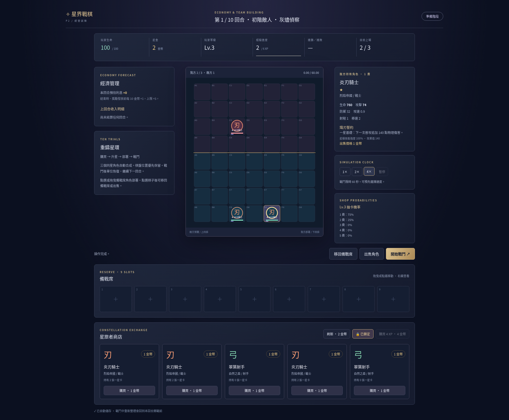

# 星界戰棋 · Astral Tactics

原創 2D 奇幻策略自走棋，**P2 Alpha · v0.2.0**。星環崩裂後，四個陣營的星旅者在破碎星庭中接受試煉。單人 PvE，以自由部署、站位與真正的自動戰鬥為核心；不需帳號、後端、資料庫或金鑰。




## P1 自由戰鬥（保留功能）

- 繁體中文主選單、12 名一星角色圖鑑、操作指南與 LocalStorage 設定。
- Phaser 3 方格棋盤（7×8），上下各四排，座標、資料與畫面分離。
- 自由選擇 12 名角色，最多部署五名，可重複選用；點選移動、拖曳、交換、移除及右鍵資訊。
- 三關固定敵陣：初階 3 名、進階 4 名、星界 5 名。
- 固定步進戰鬥：尋敵、BFS 尋路、普攻、能量、十二種獨立資料驅動技能、治療、護盾、限時增益與死亡。
- 1× / 2× / 4×、暫停、戰鬥特效、血量與能量條、傷害文字、結算與每名角色傷害統計。
- 重試保留原部署但清除戰鬥狀態；重設清空部署。戰鬥中禁止調整站位。
- 深藍紫金介面、程式繪製原創棋子、合成提示音；無外部素材、字型或 API 請求。

## P2 經營試煉

主選單新增「經營試煉」與「繼續經營」，和 P1 共用戰鬥核心，但隊伍取得方式獨立。新旅程初始 **100 HP、10 金幣、Lv.2、0 XP、空棋盤與空備戰席**。

### 商店與備戰席操作

1. 每回合準備階段有五格商店，顯示角色、費用、陣營、職業與持有的一星卡數。點「購買」後進入九格備戰席；已購買商品不可再買。
2. 點備戰席角色，再點我方棋格部署；亦可拖曳至棋盤。點棋盤或備戰席另一角色會交換位置，空格則移動。角色皆有唯一 ID，允許多個同名實例。
3. 棋盤角色可拖回指定備戰席格，或按「移回備戰席」。備戰席之間也可拖曳交換。右鍵查看有效數值；選取角色後可出售。
4. 「刷新」花費 2 金幣。鎖店會保留本次商品及售出空格至下一回合，鎖定持續到手動解除；手動刷新仍可使用。
5. 商店、販售、經驗與部署僅在準備階段可操作。戰鬥前可先選擇速度，戰鬥中支援暫停和加速。
6. 滿備戰席時會先試算合成：如果購買可立即合成，就允許；否則完全回滾，不扣款、不耗卡、不更改商品或 ID。

個人卡池每名角色依費用分別有 **30／25／20／15／12 張**。商店占用庫存；刷新退回未售商品；販售按內含卡數歸還。抽卡採可注入種子與保存的亂數狀態。同費用角色依剩餘張數加權。費用池耗盡時安全重分配到其他有庫存費用，全池耗盡顯示空格，不無限重抽。

### 經濟與收入

回合結束先更新連勝／敗，然後計算收入，最後發放自然經驗。戰敗不額外扣金幣。

| 項目       | 規則                                         |
| ---------- | -------------------------------------------- |
| 基本收入   | 第 1 回合 +3、第 2 回合 +4、第 3～10 回合 +5 |
| 利息       | 以本回合發獎前金幣，每 10 金幣 +1，上限 +5   |
| 連勝／連敗 | 2～3 次 +1，4～5 次 +2，6 次以上 +3          |
| 平局       | 勝敗連續計數皆歸零，無連續獎勵               |
| 特殊獎勵   | 由回合資料保留欄位，P2 目前均為 0            |
| 販售       | 原始費用 × 內含一星卡數，全額退還            |

頂部顯示金幣、HP、等級、XP、連續勝敗與上場數；左側顯示利息預估與上回合收入明細。金幣改變有視覺回饋。每筆交易完成後檢查庫存守恆和有效數值，結算由回合編號與階段防止重複發獎。

### 自動升星

三隻相同角色、相同星級自動合成，跨備戰席與棋盤搜尋；一星 → 二星 → 三星可連鎖，最高三星。不會合成不同角色或消耗三星。

| 星級 | 內含一星卡 | 生命 | 普攻 | 技能效果 |
| ---- | ---------: | ---: | ---: | -------: |
| ★    |          1 | 100% | 100% |     100% |
| ★★   |          3 | 180% | 150% |     135% |
| ★★★  |          9 | 320% | 230% |     180% |

生命與普攻四捨五入為整數，技能效果保留精度後在傷害公式取整。防禦、攻速、移速維持基礎值；相關增益技能的效果值隨星級成長。治療上限、血條與超時生命比例都使用有效最大生命，原始角色資料不變。

位置優先保留棋盤（列、欄、ID 排序），其次備戰席（格位、ID 排序）。合成後移除被消耗單位，卡片總數不變。升星有金紫光效、角色提示、合成提示音和星級更新，關閉動畫／音效不影響資料。

### 玩家等級與抽卡機率

每回合結束自然獲得 2 XP；花 4 金幣可購買 4 XP。升級保留超額 XP，可跨多級；Lv.9 不再累積 XP。上場人數等於玩家等級（1～9）。

| 等級 | 升至下級所需 XP | 上場上限 | 1 費 | 2 費 | 3 費 | 4 費 | 5 費 |
| ---- | --------------: | -------: | ---: | ---: | ---: | ---: | ---: |
| 1    |               2 |        1 | 100% |   0% |   0% |   0% |   0% |
| 2    |               2 |        2 | 100% |   0% |   0% |   0% |   0% |
| 3    |               6 |        3 |  75% |  25% |   0% |   0% |   0% |
| 4    |              10 |        4 |  55% |  30% |  15% |   0% |   0% |
| 5    |              20 |        5 |  45% |  33% |  20% |   2% |   0% |
| 6    |              32 |        6 |  30% |  40% |  25% |   5% |   0% |
| 7    |              48 |        7 |  19% |  30% |  35% |  15% |   1% |
| 8    |              64 |        8 |  15% |  25% |  30% |  25% |   5% |
| 9    |            滿級 |        9 |  10% |  20% |  30% |  30% |  10% |

升級立即影響上場上限和之後刷新的機率，**不重抽目前已展示的商品**。

### 十回合試煉

| 回合 | 敵陣主題            |      敵人數 |
| ---- | ------------------- | ----------: |
| 1    | 初階敵人 · 灰燼偵察 |           1 |
| 2    | 普通敵人 · 翠風前線 |           2 |
| 3    | 普通敵人 · 雷光巡衛 |           3 |
| 4    | 強化敵人 · 森林壁壘 |           4 |
| 5    | 精英敵人 · 熾羽軍團 |           5 |
| 6    | 普通敵人 · 群星集結 |           5 |
| 7    | 強化敵人 · 年輪之誓 | 5，包含二星 |
| 8    | 精英敵人 · 裁決前夕 | 6，包含二星 |
| 9    | 強化敵人 · 破碎星門 | 6，包含二星 |
| 10   | 最終試煉 · 星環重鑄 | 7，包含二星 |

敵人由 `rounds.ts` 管理，最多可擴充到九名。每場使用全新的 Battle，持有角色與初始站位不被戰鬥移動或死亡改寫。

戰敗扣除 `2 + floor(回合 / 3) + 敵方存活數` HP；平局扣 2，HP 最低 0。結算後發收入與 2 XP，確認後進入下回合。HP 歸零顯示「挑戰失敗」；存活至第 10 回合結束顯示「試煉完成」（即使該回合戰敗）。最終畫面展示完成回合、等級、HP、金幣、最高連勝、累計傷害、最終持有角色與最高星級，並可重新開始。

P2 預設敵陣偏寬鬆，目標是練習經營；勝負公式與 HP 規則保持需求值，後續再做平衡調整。

### 本機存檔

重要操作、開戰前與結算後自動保存至 LocalStorage。保存版本、回合階段、玩家與經濟、完整持有角色及站位、商店鎖定、卡池、種子／RNG 狀態和累積統計。

重新整理後從主選單選「繼續經營」。若原本在戰鬥中，回到當回合準備階段，保留已完成購買、金幣與站位；不保存逐幀戰鬥。若已在結算，恢復同一結算畫面，不再發獎。

載入會檢查版本、型別、數值、唯一 ID、棋格／備戰席容量、卡池守恆、回合及領獎狀態。損壞或版本不相容時顯示原因，可重新開始，也不影響 P1。儲存權限或容量不足會警告，遊戲繼續在記憶體運作。新旅程覆寫舊進度；只支援單分頁本機保存，不同步至其他裝置。

## 技術與啟動

使用 TypeScript、Vite、Phaser 3、HTML5、CSS3、Vitest、Playwright、npm。建議 Node.js 24 LTS（Vite 要求 Node 20.19+ 或 22.12+）。支援現代 Windows Chrome / Edge；雲端實測為 Linux Chromium，未直接測試 Windows。

```bash
npm install
npm run dev
```

開啟 Vite 顯示的網址，路徑為 `/astral-tactics/`。正式版：

```bash
npm run build
npm run preview
```

## P1 自由戰鬥操作

1. 主選單點「自由戰鬥」（P1），選擇左側試煉。
2. 選擇下方備戰區角色，點我方下半場空格部署；最多五名。空隊不能開始。
3. 點選我方棋子，再點空格移動或點另一棋子交換；也可拖曳。拖至棋盤外緣或點「移回備戰區」移除。
4. 右鍵棋子查看數值與技能；戰鬥中左鍵亦可查看。
5. 點「開始戰鬥」，角色自動行動。右側調速、暫停／繼續；結束後重試或回選單。
6. 音效、動畫與畫面品質可在設定中切換。瀏覽器禁止儲存時使用記憶體設定，不阻擋遊戲。

1920×1080 與 1366×768 皆可操作。較矮視窗可垂直捲動至備戰區，窄視窗切換單欄。

## 戰鬥規則

- 所有距離為 Manhattan 方格距離。四方向移動，最多一個存活單位佔一格。格座標與渲染座標獨立，未實作六角格。
- 模擬步長 **50ms**。每步更新尋敵與各計時器；移動冷卻 `1 / moveSpeed` 秒，普攻冷卻 `1 / attackSpeed` 秒。渲染累積時間後固定步進，速度倍率作用於模擬時間；每渲染幀最多採樣 250ms，背景分頁不追趕整段離線時間。
- 優先最近存活敵人，同距離取低絕對 HP，再依固定 ID 排序。單位按 ID 穩定執行；死亡立即失去行動能力。同一步有先手順序，沒有隨機性。
- BFS 不穿過存活單位；若最近敵人被包圍，嘗試走向其他可達敵人，定期重試。所有戰鬥最長 60 秒，無路也不會無限執行。
- 物理傷害：`max(1, round(power × 100 / (100 + defense)))`。
- 魔法傷害：`max(1, round(power × 100 / (100 + defense × 0.5)))`。
- 護盾先吸收，再扣 HP；盾值不小於零。統計傷害為實際扣除的 HP（不含護盾吸收及過量傷害）。HP 到零立即死亡，不可再受治療或行動。
- 治療不超過最大 HP；優先生命比例最低存活友方，同值按 ID。治療統計只計實際恢復量。
- 普攻後獲得 22 能量，受擊獲得 8（包含全額被盾吸收的命中），不超過上限。起始 20，上限 100；滿能量自動施法後歸零，施法間隔至少 1.2 秒。
- 攻速強化持續 5 秒，防禦強化持續 6 秒，不疊加但刷新；護盾疊加至吸收完畢或本場結束。技能數值、類型與說明集中於資料檔。
- 全滅優先結算：敵方全滅勝利，我方全滅失敗，雙方全滅平局。達 60 秒雙方仍存活時，先比較存活數，再比較各存活單位 `HP / maxHP` 的總和；相同平局。

## 測試

```bash
npm ci
npm test
npm run build
npx playwright install chromium
npm run test:e2e
```

若使用系統 Chromium（本雲端環境）：

```bash
PLAYWRIGHT_CHROMIUM_EXECUTABLE_PATH=/usr/bin/chromium npm run test:e2e
```

Windows PowerShell 可先設定 `$env:PLAYWRIGHT_CHROMIUM_EXECUTABLE_PATH`；一般使用 Playwright 安裝的 Chromium 不需此變數。

Vitest 覆蓋角色資料、部署／交換／移除／上限、AI 排序、BFS、十二技能、護盾公式、治療上限、buff、固定時間、暫停與加速、無目標、死亡、勝負／平局／超時、三關完整模擬、座標唯一與有限數值、可重現性及重開隔離。Playwright 覆蓋選單、設定持久化、三關、部署限制、交換／拖曳／移除、戰鬥暫停／加速、結算重試及兩種桌面寬度。畫面測試會更新 `public/p1-battle.png`。P2 額外驗證交易原子性、庫存守恆、升星、等級與經濟、一次性結算、真實十回合戰鬥、存檔往返與損壞防護；端對端涵蓋 1366／1920 經營流程、原生拖曳、檢查點恢復、鎖店、回合推進與販售，並產生 `public/p2-economy.png`。

## 專案結構

```text
src/
  main.ts                 # DOM UI、流程與玩家輸入協調
  game/
    core/                 # 型別、部署、固定步進戰鬥（不依賴 Phaser）
    data/                 # 原創角色、技能、固定關卡
    ai/                   # 方格規則、目標排序、BFS
    systems/              # 獨立技能執行
    scenes/               # Phaser 棋盤、互動與戰鬥特效
    run/                  # P2 型別、機率配置、商店、升星、經濟、回合、存檔驗證
  ui/RunScreen.ts         # P2 介面與輸入協調
  ui/settings.ts          # 安全設定儲存、原創合成音效
  styles/main.css         # 響應式介面
 tests/                   # 單元與瀏覽器測試
 .github/workflows/       # PR 驗證與 GitHub Pages 部署
```

`Character` 為靜態資料，`Unit` 為每場狀態；P2 的 `OwnedUnit` 與 `RunState` 保存持有資產與經營進度，`Placement.starLevel` 可選，舊版預設一星。核心只輸出事件，渲染使用事件時間，暫停時特效亦停止。

## GitHub Pages

Vite `base` 固定為 `/astral-tactics/`，產物位於 `dist/`。合併至 `main` 後，Pages workflow 執行測試與建置，透過官方 Pages artifact / deploy actions 部署；PR 另有包含瀏覽器測試的 CI。不自動合併、不更改儲存庫可見性。

管理員需至 **Settings → Pages → Build and deployment → Source → GitHub Actions** 啟用。Private 儲存庫是否可用依帳號方案而定；維持目前權限。預定網址為 `https://nobuyo0214.github.io/astral-tactics/`，加入 workflow 不代表網站已上線。

## 已知限制

- P1 使用幾何棋子、離散格移動與簡單特效，尚無立繪、背景音樂或六角格。
- 同步步進以固定 ID 順序解決同時行動，會有固定先手；雙方全滅結算已有測試，目前技能沒有反傷或自毀，因此正常戰鬥不易產生同時全滅。
- 原型數值尚未做大量平衡調校，5 費不表示必定戰勝低費。
- Phaser vendor 壓縮前約 1.2 MB，建置有 chunk size 提醒；可正常建置與載入。
- 無伺服器存檔；P2 經營進度與設定保存在本機，P1 自由隊伍不保存。畫面品質調整技能光環線條，動畫開關控制背景、戰鬥與升級特效。
- 未直接測試 Windows／真實 Edge，未確認 Pages 啟用或上線狀態。

## P3～P8 路線（尚未實作）

P2 已完成金幣、商店、玩家等級、備戰席、角色升星、十回合玩法與本機存檔。

- P3：完整羈絆、技能組合與狀態系統。
- P4：裝備、掉落與合成。
- P5：Roguelike 路線與隨機事件。
- P6：菁英／Boss、關卡與難度進程。
- P7：正式角色美術、音樂與操作打磨。
- P8：平衡、存檔、效能與發行驗證。

所有角色描述、技能、程式化視覺與音效為本專案原創；不使用其他遊戲素材。
