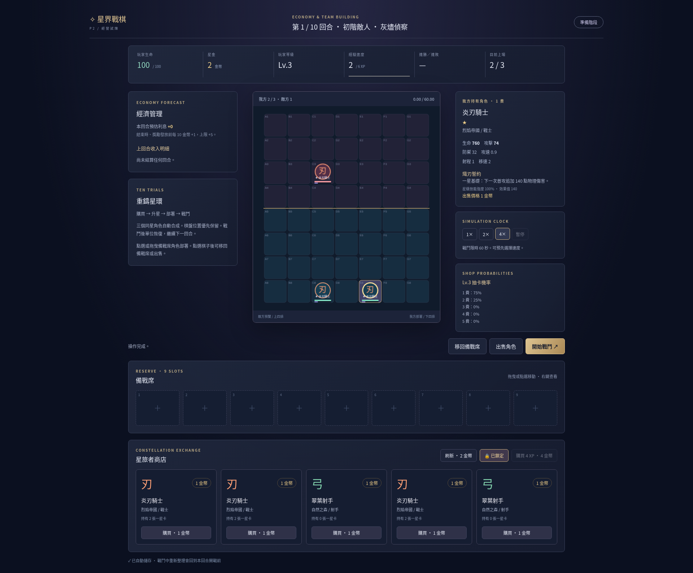

# P2: 新增角色商店、經濟管理、升星與連續回合系統

## 新功能摘要

新增「經營試煉」與「繼續經營」，玩家從 100 HP、10 金幣、Lv.2 與空隊伍開始連續挑戰十回合。提供五格商店、鎖定／刷新、有限卡池、可重現亂數、九格備戰席、角色出售、自動連鎖升星、利息／連勝敗收入、XP 與上場上限。

購買先在副本中完成合成及容量檢查，成功才提交；滿席但可合成時允許購買，失敗不改變金幣、卡池、商品或唯一 ID。結算由階段與 settledThrough 保護，不能快速連點領獎或跳回合。

版本化本機存檔保存資產、商店、卡池、RNG 與統計。戰鬥中重新整理恢復本回合開戰前；結算重新整理恢復已領取的結算，不重發獎勵。損壞或不相容存檔可安全重新開始。

## 架構調整

- `src/game/run/`：型別、機率／等級／卡池設定、種子商店、升星與位置規則、經濟、十回合敵陣、Run 狀態機與完整存檔驗證。
- `src/game/core/attributes.ts`：統一有效生命、攻擊與技能效果。Battle 的普攻、護盾、治療上限、buff 與超時比例皆使用升星後數值，不修改基礎角色資料。
- `src/ui/RunScreen.ts`：P2 畫面與玩家輸入協調，透過核心交易 API 操作資產。main.ts 僅增加模式入口。
- Phaser BoardScene 支援星級、跨區拖曳，改用有界文字物件池；每回合釋放舊 Battle，沿用場景。
- 每次提交交易與讀取存檔都檢查數值、容量、唯一 ID、卡池守恆與回合狀態。

## 遊戲畫面

深藍紫金 UI 新增玩家資源列、利息與收入、九格備戰席、五格商店、機率表、選中角色有效屬性、升星／金幣動畫與最終旅程統計。1366×768 和 1920×1080 支援垂直捲動，不橫向溢出。

## 測試結果

- `npm ci`：成功。
- `npm test`：65 項通過（包含 P1 原有 29 項）。
- `npm run build`：成功，嚴格 TypeScript 檢查通過。
- Playwright／系統 Chromium：8 項通過（包含 P1 原有 3 項）。
- P2 單元測試驗證原子交易、有限卡池與亂數、升星／販售、有效屬性、收入／XP、一次性結算、九名上場、真正十回合戰鬥、存檔往返與損壞防護。
- P2 瀏覽器測試驗證兩種桌面解析度、購買、拖曳部署、備戰席交換、棋盤拖回、販售、刷新／XP／鎖定、暫停模式的既有回歸、戰鬥檢查點、結算恢復、下一回合及實際模擬存檔的最終／失敗／重開畫面。
- `git diff --check`：通過。

## 與 P1 的相容性

「自由戰鬥」保留 12 名自由選角、三關測試、最多五名部署與全部戰鬥操作。`Placement.starLevel` 為可選欄位，舊呼叫仍預設一星。P1 的兩個測試檔未刪改，原驗證範圍維持。Vite base 仍為 `/astral-tactics/`，Pages workflow 不變；沒有直接修改、合併或部署 main。

## 設計決策與已知限制

- 鎖店維持至解除，包含售出空格；手動刷新仍可操作。
- 權重費用池耗盡後正規化剩餘費用，必要時跨費用備援；全池耗盡則空格。
- 合成保留棋盤按列／欄／ID 最先的角色，否則按備戰席格位／ID；Lv.9 不再累積 XP。
- 存活至第十回合結束即完成，該場失利但 HP 仍大於零也可完成。P2 敵陣偏寬鬆，尚待大規模平衡調整。
- 本機單分頁存檔，無跨裝置、多分頁同步或逐幀戰鬥保存。
- 未直接測試 Windows Chrome／Edge；已測 Linux Chromium。Phaser 仍有原本的非阻斷 vendor chunk size 提醒。
- Pages 啟用與線上結果不在本次測試證據範圍內，不變更可見性，不宣稱已上線。

## P3 建議

以目前有效屬性計算與事件介面擴充羈絆／技能修正器，避免把陣營加成寫進場景。先加入隊伍羈絆摘要、可測試的 modifier 疊加順序，再增加控制／持續效果與星級平衡；存檔版本改變時提供明確遷移或拒絕策略。
