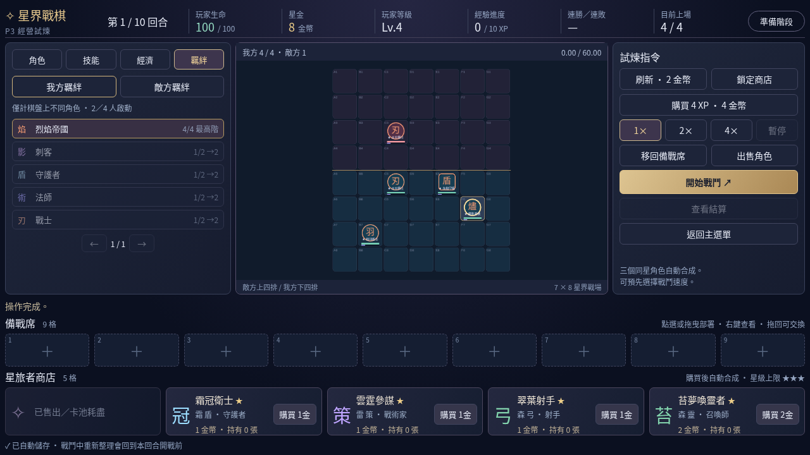
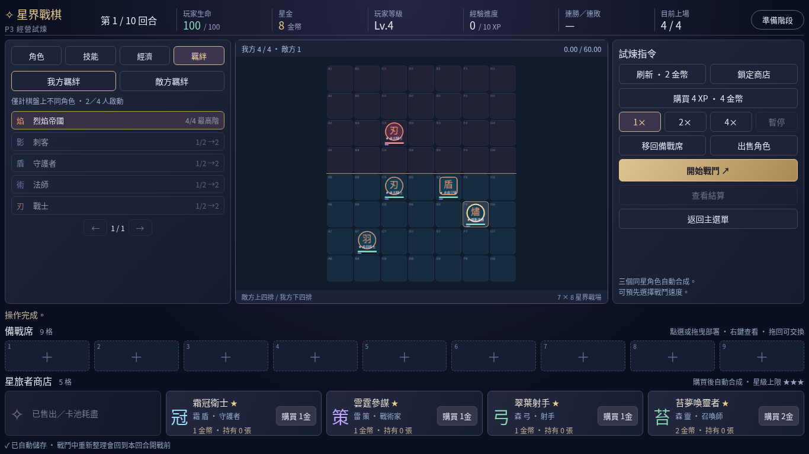
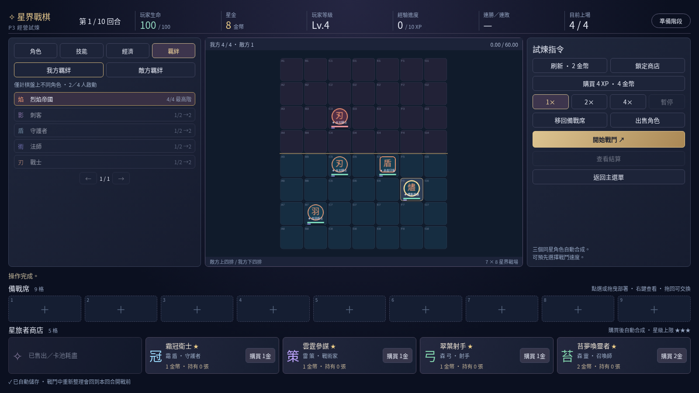
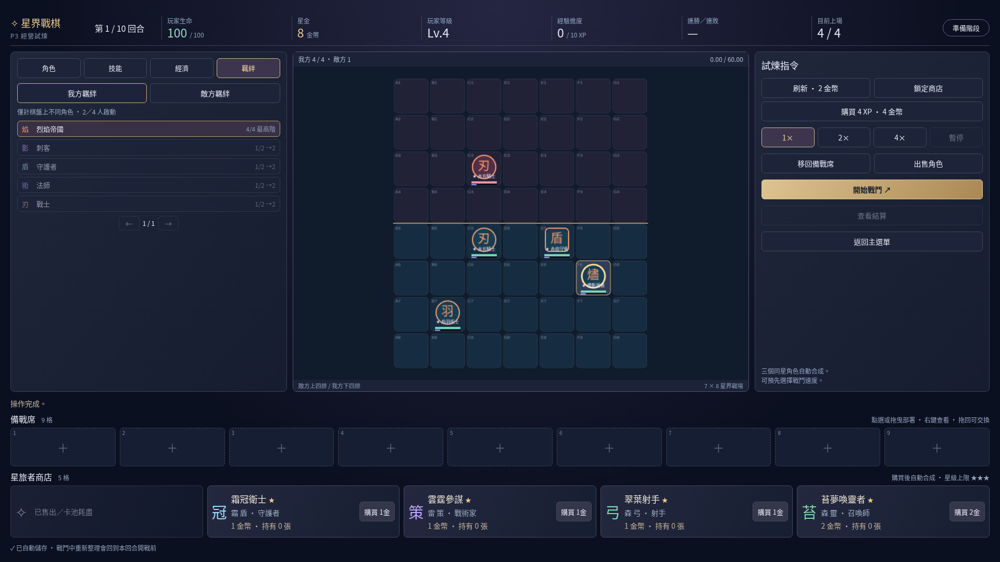

## 新增功能

P3 將既有 P1/P2 擴充為 32 名角色、八大陣營與八大職業。每種羈絆有 2／4 名不同角色階級，準備階段即時計算，開戰後鎖定快照；玩家與敵方各自套用，死亡不移除既有階級。

新增 20 名角色：燼影遊俠、苔夢喚靈者、雲霆參謀、月紗醫師、霜冠衛士、凜月舞者、雪燈術師、冰露祭司、鑄日劍衛、銅翼弩手、齒輪靈匠、鐵旗指揮官、暮影行者、幽燭療者、冥潮引靈師、夜諭先知、鎏金刃客、流金銃手、寶匣喚靈人、曜契使節。原十二名角色完整資料以舊版 fixture 鎖定。

陣營：烈焰帝國、霜月王庭、雷霆聯盟、星辰議會、鋼鐵軍團、深淵教團、自然之森、黃金商會。
職業：守護者、戰士、刺客、射手、法師、治療師、召喚師、戰術家。

## 架構與戰鬥引擎

- `game/traits` 分離規則資料、計算、快照與事件處理；固定值、百分比與星級成長分層，初始化只執行一次。
- 固定 50ms 時鐘管理燃燒、減速、冰凍、回復、能量與召喚生命週期。區分普攻、技能、持續與額外觸發傷害，避免遞迴連鎖。
- 吸血使用實扣 HP；治療依實際回復量觸發護盾。靈體每隊最多兩名、12 秒消散、不計羈絆或超時角色數。
- 刺客首次尋敵偏好後排，受阻時可改攻擊可達前排。十回合敵人使用相同規則與新角色。
- 黃金收益由開戰快照進入一次性回合收入明細，自由戰鬥不產生金幣。

## 單畫面 UI 與存檔

新增我方／敵方羈絆頁籤、分頁及有界 Tooltip；商店提示「購買並上場後」能啟動的羈絆。自由戰鬥選角分頁涵蓋 32 名角色。棋盤靜態貼圖與文字池降低重繪，像素測試確認全棋盤實際繪製位置。

沿用 LocalStorage key，版本 2 存檔先依舊卡池驗證，再補入新角色庫存並遷移版本 3；保留金幣、XP、星級、隊伍、商店、鎖定及隨機狀態。真實 P2 存檔 fixture 驗證二星角色與資源未遺失。戰鬥刷新仍恢復開戰前檢查點。

## 測試結果

- `npm ci`：成功。
- `npm test`：162 項通過，保留 P1/P2 原有驗證範圍，角色總數斷言改為 32，並額外核對原十二名。
- `npm run build`：成功；Vite base 維持 `/astral-tactics/`，Pages workflow 未修改。
- `npm run test:e2e`：21 項 Chromium 測試通過，包含 1280×720、1366×768、1600×900、1920×1080 的無捲動、元素範圍、購買、部署、交換、暫停、加速、結算與下一回合，以及縮放後輸入座標。
- `npm run test:balance`：220 場同預算、一星、Lv.8 比較；全部數值有限，事件與靈體集合有界。規則設定重構前後逐場結果相同。

## 畫面

## 平衡與已知限制

完整係數、陣容、逐場結果及前後比較見 [trait-balance.md](trait-balance.md)。目前樣本勝率 15%～90%，星辰／雷霆偏強，烈焰偏弱；沒有全勝陣容，但不宣稱已涵蓋所有星級與站位。僅調整三名新增角色；刺客尋路修正也影響最終比較，不能將所有勝率變化歸因於數值調整。

Linux 軟體 WebGL 的可重現採樣仍未穩定達 60 FPS；高低畫質原始幀時間報告均保留。生命週期壓力測試驗證有界集合，未執行完整 heap snapshot。Phaser vendor 產物仍有既有的大檔提示。

P4 建議：先擴大二三星、站位及實際經營策略樣本，再整合裝備與 TraitGrant 轉職擴充。此分支不合併 main、不發布網站。
